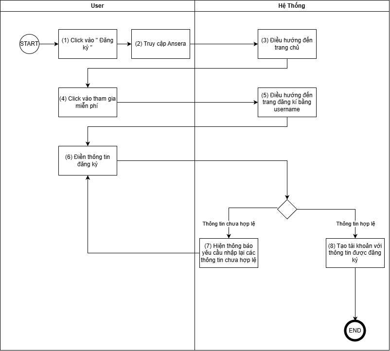
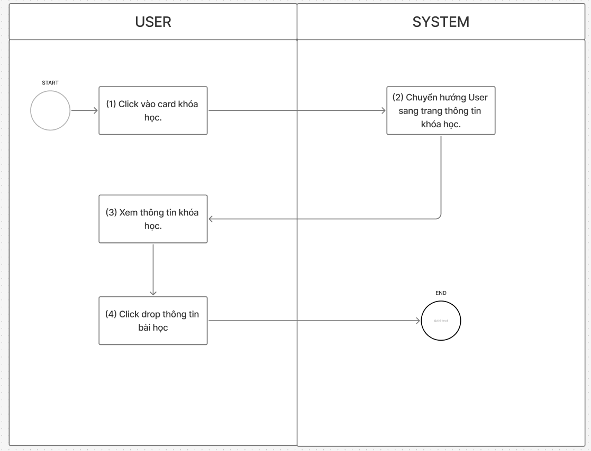
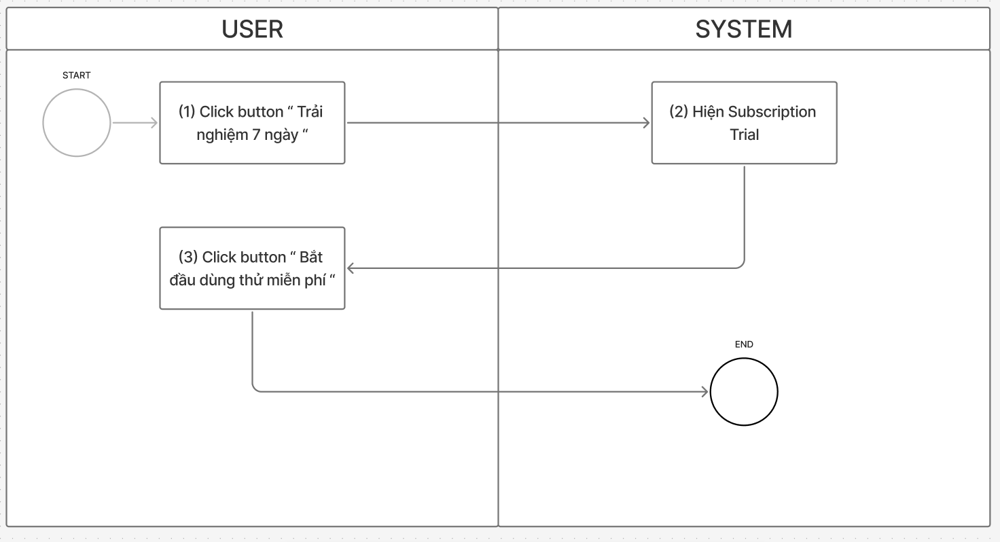
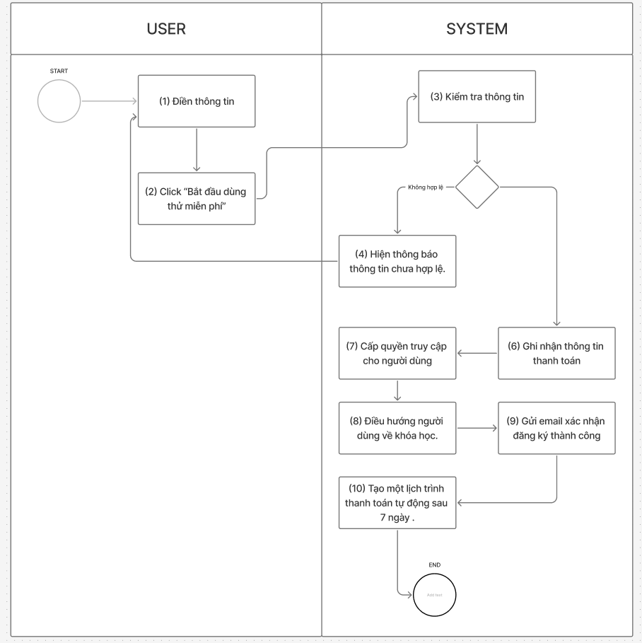

#  ĐẶC TẢ USER STORIES
**Tác giả:** Duong Duc An

---

## 1. Phụ lục Thông báo (Message Catalog)

| Mã MSG     |    Loại    | Nội dung thông báo                     | Điều kiện xuất hiện                                                                                          |
| ----------- | :---------: | ----------------------------------------- | ----------------------------------------------------------------------------------------------------------------- |
| **MSG-001** |    Lỗi    | Vui lòng nhập thông tin                | Khi người dùng bỏ trống các trường thông tin bắt buộc và bấm gửi                                    |
| **MSG-002** | Cảnh báo | Tên người dùng đã tồn tại         | Khi người dùng điền một username đã tồn tại trong hệ thống để đăng ký                            |
| **MSG-003** |    Lỗi    | Thông tin chưa hợp lệ                 | - Khi mật khẩu xác nhận không khớp - Khi thông tin điền sai định dạng (email, format thẻ, CVV...) |
| **MSG-004** | Thông báo | Bạn đã đăng ký khóa học này rồi | Khi học viên click "Đăng ký ngay" đối với khóa học đã đăng ký/sở hữu trước đó                |

---

## 2. Danh mục User Stories tổng quan

| Mã Story       | Nội dung User Story (As a / I want / So that)                                                                                                                                                                                         | Độ ưu tiên |
| --------------- | -------------------------------------------------------------------------------------------------------------------------------------------------------------------------------------------------------------------------------------- | :------------: |
| **US-AUTH-001** | **As a** khách truy cập mới **I want to** đăng ký tài khoản bằng username và mật khẩu **So that** tôi sở hữu tài khoản định danh để học tập và lưu tiến trình                                         | Must Have (P0) |
| **US-CRS-002**  | **As a** học viên đã đăng nhập **I want to** xem chi tiết giáo trình, thông tin giảng viên và đánh giá khóa học **So that** tôi hiểu rõ giá trị khóa học trước khi quyết định học thử hoặc mua | Must Have (P0) |
| **US-ENR-003**  | **As a** học viên chưa sở hữu khóa học **I want to** đăng ký trải nghiệm học thử miễn phí trong 7 ngày **So that** tôi đánh giá chất lượng bài giảng thực tế trước khi thanh toán phí định kỳ |   High (P1)   |
| **US-PAY-004**  | **As a** học viên tham gia học thử 7 ngày **I want to** nhập thông tin thẻ Visa/Mastercard hợp lệ **So that** tôi hoàn tất xác thực và hệ thống tự động gia hạn thuê bao sau 7 ngày nếu hài lòng      | Must Have (P0) |

---

## 3. Chi tiết đặc tả User Stories & Acceptance Criteria

### 3.1. US-AUTH-001: Đăng ký tài khoản học viên mới bằng Username & Password

**As a** khách truy cập mới chưa có tài khoản trên ANSERA
**I want to** đăng ký tài khoản bằng username và mật khẩu cá nhân
**So that** tôi sở hữu tài khoản định danh trên nền tảng, lưu trữ lộ trình học và sử dụng các tính năng học tập cá nhân hóa.

*US1-Màn hình trang chủ*

*US1-Màn hình đăng ký bằng username*

*US1-Flow*

#### Bảng mô tả thành phần giao diện

| STT | Tên thành phần | Type | Được chỉnh sửa | Bắt buộc | Giá trị mặc định | Mô tả |
| :---: | --- | :---: | :---: | :---: | :---: | --- |
| 1 | Button tham gia miễn phí | Button | N/A | N/A | N/A | Nút kêu gọi hành động trên header/banner trang chủ. |
| 2 | Button tham gia miễn phí | Button | N/A | N/A | N/A | Nút kêu gọi hành động ở phần thân trang chủ. |
| 3 | Trường thông tin username | Text | Yes | Yes | N/A | - Trường thông tin username bắt buộc user phải điền. - Nếu bỏ trống và bấm Đăng ký: hiển thị **MSG-001** *"Vui lòng nhập thông tin"* và đổi viền khung sang màu đỏ. |
| 4 | Trường thông tin password | Text | Yes | Yes | N/A | - Trường mật khẩu bắt buộc nhập, hiển thị ký tự dạng `*`. - Tối thiểu 8 ký tự, cho phép ký tự đặc biệt. - Nhấn giữ biểu tượng con mắt bên phải để xem mật khẩu. - Nếu bỏ trống và gửi: hiển thị **MSG-001** *"Vui lòng nhập thông tin"* và đổi viền khung sang đỏ. - Nếu username đã tồn tại: hiển thị **MSG-002** *"Tên người dùng đã tồn tại"*. |
| 5 | Trường thông tin nhập lại mật khẩu | Text | Yes | Yes | N/A | - Nội dung phải trùng khớp 100% với mật khẩu đã nhập. - Nhấn giữ biểu tượng con mắt bên phải để xem mật khẩu. - Nếu bỏ trống và gửi: hiển thị **MSG-001** *"Vui lòng nhập thông tin"* và viền khung đỏ. - Nếu không khớp: hiển thị **MSG-003** *"Thông tin chưa hợp lệ"* và đổi viền khung sang đỏ. |
| 6 | Button đăng ký | Button | N/A | N/A | N/A | - Khi user điền đầy đủ thông tin, click để gửi thông tin và tạo tài khoản. - Đăng ký thành công điều hướng về trang chủ với trạng thái đăng nhập. |
| 7 | Button đăng ký bằng Google | Button | N/A | N/A | N/A | Chuyển hướng người dùng tới màn hình đăng ký bằng tài khoản Google. |
| 8 | Button đăng ký bằng Facebook | Button | N/A | N/A | N/A | Chuyển hướng người dùng tới màn hình đăng ký bằng tài khoản Facebook. |
| 9 | Link đăng nhập | Link | N/A | N/A | N/A | Click để chuyển hướng sang trang Đăng nhập nếu đã có tài khoản. |
| 10 | Link điều khoản | Link | N/A | N/A | N/A | Click để chuyển hướng tới trang điều khoản dịch vụ của ANSERA. |
| 11 | Link chính sách bảo mật | Link | N/A | N/A | N/A | Click để chuyển hướng tới trang chính sách bảo mật của ANSERA. |

#### Acceptance Criteria 

- **AC1: Đăng ký thành công với thông tin hợp lệ (Happy path)**

  - **Given** người dùng đang ở trang đăng ký tài khoản ANSERA và chưa đăng nhập
  - **When** người dùng nhập `username` chưa tồn tại trong hệ thống, `password` hợp lệ (tối thiểu 8 ký tự), `confirm password` trùng khớp 100% với `password`, và nhấn nút "Đăng ký"
  - **Then** hệ thống tạo tài khoản mới với trạng thái kích hoạt thành công
  - **And** tự động đăng nhập và điều hướng người dùng về trang chủ (Homepage) với trạng thái đã xác thực.
- **AC2: Bỏ trống một hoặc nhiều trường bắt buộc (Edge case / Validation)**

  - **Given** người dùng đang ở form đăng ký
  - **When** người dùng bỏ trống ít nhất một trong ba trường (`username`, `password`, `confirm password`) và nhấn nút "Đăng ký"
  - **Then** hệ thống chặn gửi dữ liệu và hiển thị thông báo lỗi `MSG-001`: *"Vui lòng nhập thông tin"* tại các trường bị bỏ trống.
- **AC3: Trùng Username đã tồn tại (Negative path / Duplicate)**

  - **Given** một tài khoản đã tồn tại trong hệ thống với username là `duc_an2026`
  - **When** người dùng mới nhập `username` là `duc_an2026`, điền mật khẩu hợp lệ và nhấn nút "Đăng ký"
  - **Then** hệ thống không tạo tài khoản mới và hiển thị cảnh báo `MSG-002`: *"Tên người dùng đã tồn tại"*.
- **AC4: Mật khẩu xác nhận không khớp hoặc mật khẩu yếu (Negative path)**

  - **Given** người dùng đang ở form đăng ký
  - **When** người dùng nhập mật khẩu dưới 8 ký tự HOẶC nhập mật khẩu xác nhận không trùng khớp
  - **Then** hệ thống chặn đăng ký, viền khung trường bị đổi sang màu đỏ và hiển thị lỗi `MSG-003`: *"Thông tin chưa hợp lệ"*.

---

### 3.2. US-CRS-002: Xem chi tiết thông tin khóa học, giảng viên và đánh giá

**As a** học viên đã đăng nhập vào ANSERA
**I want to** xem chi tiết đề cương khóa học (giáo trình theo tuần), hồ sơ giảng viên và đánh giá từ học viên trước
**So that** tôi hiểu rõ nội dung, kiến thức đạt được và đánh giá mức độ phù hợp trước khi quyết định học thử hoặc mua.

*US2-Khóa học phổ biến*

*US2-Thông tin khóa học*

*US2-Thông tin tuần học*

*US2-Thông tin giảng viên và đánh giá*

*US2-Flow*

#### Bảng mô tả thành phần giao diện

| STT | Tên thành phần | Type | Được chỉnh sửa | Bắt buộc | Giá trị mặc định | Mô tả |
| :---: | --- | :---: | :---: | :---: | :---: | --- |
| 0 | Card khóa học | Card | N/A | N/A | N/A | - Hiển thị tóm tắt: Đơn vị cung cấp, tên khóa, đánh giá rating, số học viên, cấp độ. - Click vào để chuyển hướng đến trang chi tiết khóa học. |
| 1 | Biểu tượng người dùng | Button | N/A | N/A | N/A | Biểu tượng avatar tài khoản. Click vào để chuyển hướng tới trang Quản lý tài khoản cá nhân. |
| 2 | Button đăng ký ngay | Button | N/A | N/A | N/A | - Click để chuyển hướng đến trang điền thông tin thanh toán mua khóa học. - Nếu khóa học đã được đăng ký trước đó: hiển thị **MSG-004** *"Bạn đã đăng ký khóa học này rồi"*. |
| 3 | Button Học thử | Button | N/A | N/A | N/A | Click để bắt đầu trải nghiệm học thử 7 ngày; hiển thị popup modal thông tin dùng thử. |
| 4 | Button play video | Button | N/A | N/A | N/A | Click để phát video giới thiệu tổng quan khóa học. |
| 5 | Button drop thông tin bài học | Button | N/A | N/A | N/A | Click vào mũi tên xổ xuống ở cuối tên bài học để bung mở nội dung tóm tắt bài học (accordion). |
| 6 | Button bắt đầu dùng thử miễn phí | Button | N/A | N/A | N/A | Click để xác nhận trải nghiệm 7 ngày và chuyển hướng sang màn hình thanh toán liên kết thẻ. |

#### Acceptance Criteria

- **AC1: Hiển thị đầy đủ thông tin khóa học (Happy path)**

  - **Given** học viên đã đăng nhập và đang xem danh mục khóa học
  - **When** học viên click vào một thẻ khóa học (Course Card) bất kỳ
  - **Then** hệ thống chuyển hướng đến trang chi tiết khóa học, hiển thị đầy đủ: tên khóa, bên cung cấp, cấp độ, video intro, giáo trình tuần, thông tin giảng viên, đánh giá, cùng 2 nút hành động: "Đăng ký ngay" và "Trải nghiệm 7 ngày".
- **AC2: Mở rộng tóm tắt bài học qua Accordion (Edge case / Interaction)**

  - **Given** học viên đang ở mục "Giáo trình tuần học"
  - **When** học viên click vào biểu tượng mũi tên xổ xuống tại một bài học
  - **Then** hệ thống bung mở bản mô tả tóm tắt nội dung bài học đó mà không tải lại toàn bộ trang.
- **AC3: Người dùng đã sở hữu khóa học bấm Đăng ký ngay (Negative path)**

  - **Given** học viên đang ở trang chi tiết của khóa học mà tài khoản này đã sở hữu trước đó
  - **When** học viên nhấn vào nút "Đăng ký ngay"
  - **Then** hệ thống không mở luồng thanh toán và hiển thị thông báo `MSG-004`: *"Bạn đã đăng ký khóa học này rồi"*.

---

### 3.3. US-ENR-003: Đăng ký trải nghiệm học thử miễn phí trong 7 ngày

**As a** học viên đã đăng nhập và chưa từng tham gia khóa học đang chọn
**I want to** kích hoạt gói trải nghiệm học thử 7 ngày miễn phí
**So that** tôi có thể trải nghiệm các bài học thực tế trong 7 ngày trước khi quyết định chi trả phí duy trì hàng tháng.

*US2-Thông tin khóa học*

*US3-Dùng thử miễn phí 7 ngày*

*US3-Flow*

#### Bảng mô tả thành phần giao diện

| STT | Tên thành phần | Type | Được chỉnh sửa | Bắt buộc | Giá trị mặc định | Mô tả |
| :---: | --- | :---: | :---: | :---: | :---: | --- |
| 1 | Biểu tượng người dùng | Button | N/A | N/A | N/A | Biểu tượng avatar tài khoản. Click để chuyển hướng sang trang Quản lý tài khoản. |
| 2 | Button đăng ký ngay | Button | N/A | N/A | N/A | - Chuyển hướng tới trang thanh toán mua khóa học. - Nếu khóa học đã sở hữu: hiển thị **MSG-004** *"Bạn đã đăng ký khóa học này rồi"*. |
| 3 | Button trải nghiệm 7 ngày | Button | N/A | N/A | N/A | Click để mở popup modal tóm tắt quyền lợi và chính sách học thử 7 ngày miễn phí. |
| 4 | Button play video | Button | N/A | N/A | N/A | Click để phát video giới thiệu bài học/khóa học. |
| 6 | Button bắt đầu dùng thử miễn phí | Button | N/A | N/A | N/A | Nằm trong popup modal. Click để xác nhận bắt đầu dùng thử và điều hướng đến màn hình thanh toán. |

#### Acceptance Criteria 

- **AC1: Hiển thị modal đặc quyền học thử và điều hướng thanh toán (Happy path)**

  - **Given** học viên đang xem chi tiết khóa học chưa từng học thử hoặc đăng ký
  - **When** học viên nhấn nút "Trải nghiệm 7 ngày"
  - **Then** hệ thống hiển thị modal thông báo đặc quyền học thử 7 ngày (thời hạn 7 ngày, quyền truy cập bài học trial, cam kết không trừ tiền trước ngày thứ 7) kèm nút "Bắt đầu dùng thử miễn phí"
  - **And** khi học viên click nút "Bắt đầu dùng thử miễn phí", hệ thống chuyển hướng đến trang nhập thông tin thanh toán (US-PAY-004).
- **AC2: Đã từng sử dụng gói học thử cho khóa học này (Negative path)**

  - **Given** học viên đã từng kích hoạt gói học thử 7 ngày cho khóa học này trước đây
  - **When** học viên truy cập trang chi tiết khóa học
  - **Then** nút "Trải nghiệm 7 ngày" bị vô hiệu hóa (disabled) kèm thông báo giải thích quyền học thử chỉ áp dụng 1 lần duy nhất cho mỗi khóa học.
- **AC3: Kích hoạt quyền học thử sau khi liên kết thẻ thành công (Post-condition)**

  - **Given** học viên hoàn tất xác thực thông tin thanh toán tại US-PAY-004
  - **When** hệ thống kích hoạt gói dùng thử
  - **Then** trạng thái khóa học của học viên chuyển sang `TRIAL_ACTIVE`, đồng hồ đếm ngược 7 ngày bắt đầu chạy và gửi email xác nhận thành công.

---

### 3.4. US-PAY-004: Liên kết thẻ thanh toán quốc tế và thiết lập tự động gia hạn sau dùng thử

**As a** học viên đăng ký trải nghiệm học thử 7 ngày
**I want to** nhập thông tin thẻ thanh toán quốc tế (Visa/Mastercard) hợp lệ
**So that** tôi hoàn tất xác nhận tham gia và hệ thống tự động gia hạn thuê bao sau 7 ngày nếu tôi hài lòng mà không bị gián đoạn học tập.

*US4-Màn hình điền thông tin thanh toán trải nghiệm 7 ngày*

*US4-Flow*

#### Bảng mô tả thành phần giao diện

| STT | Tên thành phần | Type | Được chỉnh sửa | Bắt buộc | Giá trị mặc định | Mô tả |
| :---: | --- | :---: | :---: | :---: | :---: | --- |
| 1 | Trường thông tin họ và tên | Text | Yes | Yes | N/A | - User điền họ tên in trên thẻ (không chứa số hoặc ký tự đặc biệt). - Nếu bỏ trống: hiển thị **MSG-001** *"Vui lòng nhập thông tin"*. |
| 2 | Trường thông tin Email | Text | Yes | Yes | N/A | - User điền địa chỉ email theo đúng định dạng chuẩn. - Nếu bỏ trống: hiển thị **MSG-001** *"Vui lòng nhập thông tin"*. - Nếu sai cú pháp email: hiển thị **MSG-003** *"Thông tin chưa hợp lệ"*. |
| 3 | Droplist quốc gia | List | Yes | Yes | N/A | Click vào mũi tên xổ xuống để chọn quốc gia phát hành thẻ/cư trú từ danh sách. |
| 4 | Trường thông tin số thẻ | Text | Yes | Yes | N/A | - User nhập dãy số thẻ quốc tế (Visa/Mastercard). - Nếu bỏ trống: hiển thị **MSG-001** *"Vui lòng nhập thông tin"*. - Nếu nhập sai cấu trúc/thuật toán Luhn: hiển thị **MSG-003** *"Thông tin chưa hợp lệ"*. |
| 5 | Trường thông tin ngày hết hạn | Text | Yes | Yes | N/A | - Định dạng chuẩn theo placeholder `MM/YY` (thời điểm trong tương lai). - Nếu bỏ trống: hiển thị **MSG-001** *"Vui lòng nhập thông tin"*. - Nếu sai định dạng hoặc ngày trong quá khứ: hiển thị **MSG-003** *"Thông tin chưa hợp lệ"*. |
| 6 | Trường thông tin mã bảo vệ (CVV) | Text | Yes | Yes | N/A | - User nhập 3 chữ số bảo mật ở mặt sau thẻ. - Nếu bỏ trống: hiển thị **MSG-001** *"Vui lòng nhập thông tin"*. - Nếu không hợp lệ: hiển thị **MSG-003** *"Thông tin chưa hợp lệ"*. |
| 7 | Button bắt đầu dùng thử miễn phí | Button | N/A | N/A | N/A | Click để gửi dữ liệu xác thực thẻ qua cổng thanh toán, thiết lập subscription tự động gia hạn sau 7 ngày và kích hoạt khóa học. |

#### Acceptance Criteria 

- **AC1: Xác thực thẻ thành công và tạo subscription tự động gia hạn (Happy path)**

  - **Given** học viên đang ở màn hình thanh toán gói học thử
  - **When** học viên nhập đầy đủ: Họ tên trên thẻ, Email hợp lệ, Quốc gia, Số thẻ Visa/Mastercard hợp lệ, Ngày hết hạn hợp lệ (MM/YY trong tương lai), CVV hợp lệ (3 số), và nhấn "Bắt đầu dùng thử miễn phí"
  - **Then** cổng thanh toán xác thực thẻ thành công, mã hóa (tokenize) thông tin thanh toán và hệ thống khởi tạo lịch trình tự động gia hạn trừ tiền sau 7 ngày
  - **And** kích hoạt quyền học thử cho học viên và điều hướng về trang học tập của khóa học.
- **AC2: Bỏ trống một hoặc nhiều trường thông tin thanh toán (Edge case / Validation)**

  - **Given** học viên đang ở màn hình thanh toán
  - **When** học viên để trống bất kỳ trường nào trong các trường bắt buộc và nhấn "Bắt đầu dùng thử miễn phí"
  - **Then** hệ thống chặn gửi dữ liệu và hiển thị thông báo lỗi `MSG-001`: *"Vui lòng nhập thông tin"* tại các trường bị bỏ trống.
- **AC3: Nhập sai định dạng dữ liệu hoặc thông tin thẻ không hợp lệ (Negative path)**

  - **Given** học viên đang ở màn hình thanh toán
  - **When** học viên nhập email sai cú pháp, họ tên chứa số/ký tự đặc biệt, số thẻ sai thuật toán Luhn hoặc ngày hết hạn trong quá khứ và bấm gửi
  - **Then** hệ thống chặn gửi dữ liệu và hiển thị thông báo lỗi `MSG-003`: *"Thông tin chưa hợp lệ"*.
- **AC4: Thẻ bị từ chối từ ngân hàng phát hành (Negative path / Gateway Decline)**

  - **Given** thông tin thẻ đúng định dạng nhưng thẻ bị khóa, không hỗ trợ giao dịch online hoặc không đủ điều kiện xác thực từ ngân hàng
  - **When** học viên gửi yêu cầu xác thực
  - **Then** cổng thanh toán trả về lỗi, hệ thống không tạo subscription và hiển thị thông báo hướng dẫn học viên kiểm tra lại tình trạng thẻ hoặc sử dụng thẻ khác.

---
