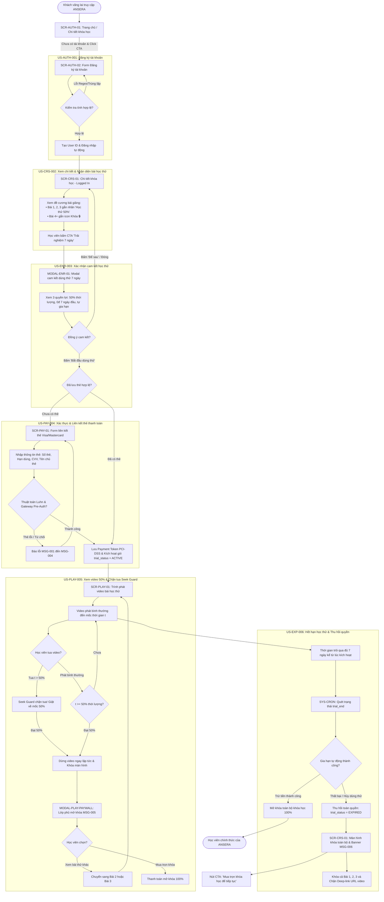
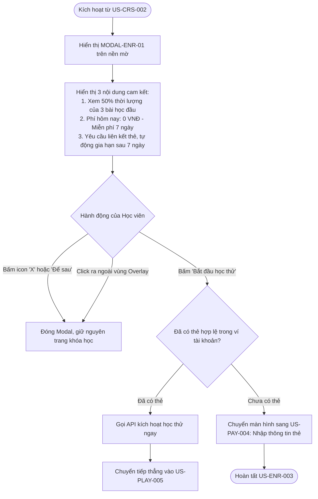
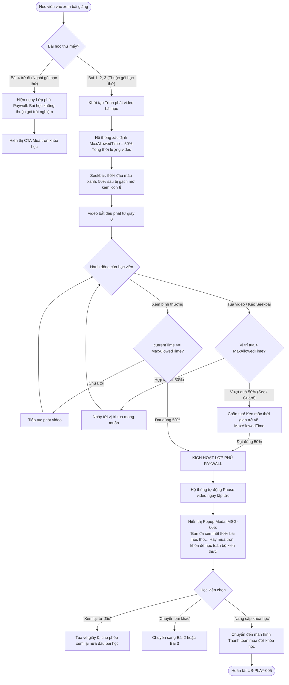

# ĐẶC TẢ LUỒNG NGƯỜI DÙNG (USER FLOW SPECIFICATION)
## Tính năng: Gói học thử 7 ngày (Trial 50% 3 bài đầu & Xác thực thẻ thanh toán)
**Dự án:** Nền tảng học trực tuyến ANSERA  
**Phiên bản:** 1.0.0  
**Tài liệu tham chiếu:** [User Story Specification.md](./User%20Story%20Specification.md)  
**Quy chuẩn áp dụng:** BA-Kit Standard / `/user-flow` Core Workflow

---

## 1. Sơ đồ luồng tổng quan End-to-End (E2E Master User Flow)

Sơ đồ thể hiện toàn bộ hành trình của người dùng từ khi là khách vãng lai (Guest) ghé thăm ANSERA cho tới khi trải nghiệm trọn vẹn 7 ngày học thử và kết thúc chu kỳ (gia hạn thành công hoặc thu hồi quyền truy cập).



---

## 2. Chi tiết luồng người dùng (User Flow) cho từng User Story

### 2.1. US-AUTH-001: Đăng ký tài khoản học viên mới bằng Username & Password

#### A. Điểm chạm & Danh sách màn hình
- **SCR-AUTH-01:** Trang chủ / Chi tiết khóa học (Header: Nút Đăng nhập / Đăng ký)
- **SCR-AUTH-02:** Màn hình Đăng ký tài khoản (`/register`)

#### B. Sơ đồ luồng thao tác (Mermaid Flowchart)
```mermaid
flowchart TD
    Start([Khách truy cập trang]) --> Step1[Click Đăng ký trên Header / CTA khóa học]
    Step1 --> Step2[Hệ thống hiển thị Form Đăng ký SCR-AUTH-02]
    Step2 --> Step3[Học viên nhập: Username, Password, Confirm Password]
    Step3 --> Step4[Click nút 'Tạo tài khoản']
    
    Step4 --> CheckEmpty{Các trường có để trống?}
    CheckEmpty -- Có --> Err1[Báo lỗi Inline: Vui lòng nhập đầy đủ thông tin]
    Err1 --> Step3

    CheckEmpty -- Không --> CheckFormat{Đúng định dạng Regex?}
    CheckFormat -- Sai Username --><br>Err2[Báo lỗi MSG-001: 5-20 ký tự, không dấu, không khoảng trắng]
    CheckFormat -- Mật khẩu yếu --><br>Err3[Báo lỗi MSG-002: Tối thiểu 8 ký tự gồm hoa, thường, số, ký tự đặc biệt]
    CheckFormat -- Không khớp Confirm --><br>Err4[Báo lỗi MSG-003: Mật khẩu xác nhận không khớp]
    Err2 & Err3 & Err4 --> Step3

    CheckFormat -- Hợp lệ Client --> ApiCall[Gửi API POST /auth/register]
    ApiCall --> CheckDup{Backend kiểm tra Username tồn tại?}
    CheckDup -- Đã tồn tại --> ErrDup[Hiển thị Toast / Inline MSG-001: Username đã tồn tại]
    ErrDup --> Step3

    CheckDup -- Hợp lệ --> CreateAcc[Tạo User ID & Khởi tạo phiên Đăng nhập JWT]
    CreateAcc --> Redirect[Chuyển hướng về Khóa học đang xem dở]
    Redirect --> End([Hoàn tất US-AUTH-001])
```

#### C. Chi tiết các luồng (Flow Breakdown)
* **Happy Path (Luồng chính):**
  1. Học viên nhấn **"Đăng ký"** từ Header.
  2. Học viên điền `username`, `password` (đủ tiêu chuẩn 8+ ký tự), `confirm_password`.
  3. Nhấn **"Tạo tài khoản"**. Hệ thống tạo tài khoản, đăng nhập tự động và điều hướng về trang khóa học.
* **Alternative Flow:**
  - Học viên click "Đã có tài khoản? Đăng nhập ngay" $\rightarrow$ Điều hướng về màn hình Đăng nhập (`/login`).
* **Error Flow:**
  - Username bị trùng: Backend trả về HTTP 409 Conflict $\rightarrow$ Báo đỏ `MSG-001`.
  - Mất kết nối khi submit: Hiển thị banner lỗi mạng, giữ nguyên giá trị đã nhập trong form.
* **Edge Cases:**
  - Double click nút submit: Nút bị vô hiệu hóa (disabled) ngay lập tức khi click lần đầu.

#### D. Ma trận trạng thái giao diện (UI States)
| Trạng thái | Biểu hiện giao diện |
| :--- | :--- |
| **Normal** | Form hiển thị 3 trường input trống, nút submit ở trạng thái sẵn sàng. |
| **Loading** | Nút "Tạo tài khoản" chuyển icon loading spinner, các trường input bị `disabled`. |
| **Error** | Viền input chuyển đỏ (`#EF4444`), câu thông báo lỗi xuất hiện ngay dưới trường nhập. |
| **Offline** | Banner màu vàng cam cảnh báo mất kết nối Internet, giữ nguyên form. |

---

### 2.2. US-CRS-002: Xem chi tiết thông tin khóa học & Nhận diện bài học thử

#### A. Điểm chạm & Danh sách màn hình
- **SCR-CRS-01:** Màn hình Chi tiết khóa học (`/courses/:slug`)
- **COMP-CRS-SIDEBAR:** Khung giá và nút CTA hành động bên phải
- **COMP-CRS-SYLLABUS:** Accordion danh sách chương mục và bài giảng

#### B. Sơ đồ luồng thao tác (Mermaid Flowchart)
```mermaid
flowchart TD
    Start([Học viên vào trang Chi tiết khóa học]) --> CheckAuth{Đã đăng nhập?}
    
    CheckAuth -- Chưa --> ViewGuest[Hiển thị giá gốc & CTA 'Đăng nhập để học thử 7 ngày']
    ViewGuest --> ClickGuest[Click CTA] --> RedirectLogin[Điều hướng sang Trang Đăng nhập / Đăng ký]
    
    CheckAuth -- Rồi --> CheckEnrollment{Trạng thái học viên?}
    CheckEnrollment -- Đã mua Full --> ViewEnrolled[Nút CTA: 'Vào học ngay' - Mở toàn bộ 100%]
    CheckEnrollment -- Đang dùng thử Active --> ViewTrialActive[Nút CTA: 'Tiếp tục học thử (Còn X ngày)']
    CheckEnrollment -- Đã hết hạn Trial --> ViewExpired[Hiển thị Badge Hết hạn trial & Nút 'Mua khóa học']
    
    CheckEnrollment -- Chưa từng dùng thử --> ViewNewTrial[Hiển thị Huy hiệu 'Học thử 50%' & CTA 'Trải nghiệm 7 ngày']
    ViewNewTrial --> InspectSyllabus[Cuộn xem Đề cương Giáo trình]
    InspectSyllabus --> CheckLessonType{Phân loại bài giảng}
    CheckLessonType -- Bài 1, 2, 3 --> TagTrial[Hiển thị Tag xanh 'Học thử 50%']
    CheckLessonType -- Bài 4 trở đi --> TagLock[Hiển thị Biểu tượng Khóa 🔒]
    
    ViewNewTrial --> ClickTrial[Click CTA 'Trải nghiệm 7 ngày']
    ClickTrial --> OpenEnrollModal[Mở MODAL-ENR-01 sang US-ENR-003]
    OpenEnrollModal --> End([Hoàn tất US-CRS-002])
```

#### C. Chi tiết các luồng (Flow Breakdown)
* **Happy Path:**
  1. Học viên đăng nhập truy cập trang chi tiết khóa học.
  2. Nhận biết trực quan 3 bài đầu tiên có gắn nhãn xanh *"Học thử 50%"*, từ bài thứ 4 trở đi bị khóa 🔒.
  3. Cột bên phải hiển thị rõ quyền lợi học thử miễn phí trong 7 ngày.
  4. Bấm CTA **"Trải nghiệm 7 ngày"** để mở modal cam kết.
* **Alternative Flow:**
  - Bấm trực tiếp vào Bài 1 trên danh sách đề cương $\rightarrow$ Hệ thống tự động kích hoạt mở modal cam kết học thử.
* **Error Flow:**
  - Không tải được dữ liệu khóa học: Hiển thị Empty/Error state kèm nút "Tải lại trang".

#### D. Ma trận trạng thái giao diện (UI States)
| Trạng thái | Biểu hiện giao diện |
| :--- | :--- |
| **Normal** | Đầy đủ thông tin giảng viên, video trailer, giáo trình chia rõ nhãn học thử và ổ khóa. |
| **Loading** | Hiển thị Skeleton loading cho toàn bộ khung nội dung. |
| **Empty** | Khóa học chưa cập nhật nội dung: Ẩn nút học thử, báo "Đang chuẩn bị bài giảng". |
| **Error** | "Không thể tải thông tin khóa học. Vui lòng thử lại." |

---

### 2.3. US-ENR-003: Đăng ký trải nghiệm học thử miễn phí trong 7 ngày

#### A. Điểm chạm & Danh sách màn hình
- **MODAL-ENR-01:** Pop-up Modal cam kết quyền lợi và điều kiện học thử 7 ngày

#### B. Sơ đồ luồng thao tác (Mermaid Flowchart)


#### C. Chi tiết các luồng (Flow Breakdown)
* **Happy Path:**
  1. Modal bật lên với nội dung rõ ràng, minh bạch về quyền lợi và việc tự động gia hạn.
  2. Học viên bấm nút **"Bắt đầu học thử"**.
  3. Hệ thống kiểm tra học viên chưa có thẻ $\rightarrow$ Điều hướng tới bước nhập thẻ (`US-PAY-004`).
* **Alternative Flow:**
  - Học viên đổi ý, bấm "Để sau" hoặc nút đóng $\rightarrow$ Modal đóng lại, không có dữ liệu nào bị lưu.

---

### 2.4. US-PAY-004: Xác thực & Liên kết thẻ thanh toán quốc tế để kích hoạt học thử

#### A. Điểm chạm & Danh sách màn hình
- **SCR-PAY-01:** Màn hình / Modal Liên kết thẻ thanh toán quốc tế (`/checkout/trial-card`)

#### B. Sơ đồ luồng thao tác (Mermaid Flowchart)
```mermaid
flowchart TD
    Start([Chuyển tiếp từ US-ENR-003]) --> RenderForm[Hiển thị Form Thẻ & Bảng tóm tắt phí 0đ]
    RenderForm --> InputData[Học viên nhập: Tên chủ thẻ, Số thẻ 16 số, MM/YY, CVV 3 số]
    InputData --> AutoFormat[Tự động cách 4 chữ số & In hoa tên chủ thẻ]
    
    InputData --> ClickConfirm[Click 'Xác thực thẻ & Kích hoạt']
    ClickConfirm --> ClientValidate{Kiểm tra Client-side?}
    
    ClientValidate -- Số thẻ sai định dạng / Luhn fail --><br>ErrCard[Báo lỗi Inline MSG-001: Số thẻ không hợp lệ]
    ClientValidate -- Quá hạn hoặc MM > 12 --><br>ErrExp[Báo lỗi Inline MSG-002: Thẻ hết hạn / không hợp lệ]
    ClientValidate -- CVV != 3 số --><br>ErrCvv[Báo lỗi Inline MSG-003: Mã CVV gồm 3 chữ số bảo mật]
    ErrCard & ErrExp & ErrCvv --> InputData

    ClientValidate -- Hợp lệ Client --> ShowProcessing[Nút bấm đổi trạng thái Loading Spinner]
    ShowProcessing --> CallGateway[Gửi thông tin thẻ qua Cổng thanh toán - Zero-Auth Check]
    
    CallGateway --> GatewayResp{Kết quả từ Ngân hàng / Gateway?}
    GatewayResp -- Thẻ hết tiền / Khóa / Từ chối --><br>Decline[Hiển thị Alert đỏ MSG-004: Thẻ bị từ chối / Không đủ điều kiện]
    Decline --> ReEnableForm[Mở lại Form để học viên nhập lại thẻ khác]
    ReEnableForm --> InputData

    GatewayResp -- Thành công / Thẻ hợp lệ --> SaveToken[Hệ thống lưu Payment Token bảo mật chuẩn PCI-DSS]
    SaveToken --> InitTrial[Cập nhật DB: trial_status = ACTIVE, trial_end = Hiện tại + 7 ngày]
    InitTrial --> ShowSuccessToast[Thông báo: Kích hoạt thành công gói học thử 7 ngày]
    ShowSuccessToast --> RouteToPlayer[Chuyển hướng vào US-PLAY-005: Xem Bài 1]
    RouteToPlayer --> End([Hoàn tất US-PAY-004])
```

#### C. Chi tiết các luồng (Flow Breakdown)
* **Happy Path:**
  1. Học viên nhập thẻ Visa/Mastercard hợp lệ.
  2. Bấm **"Xác thực thẻ & Kích hoạt"**.
  3. Cổng thanh toán xác thực thẻ thành công (Zero-Auth / Pre-auth).
  4. Hệ thống lưu Payment Token, kích hoạt gói 7 ngày, điều hướng vào màn hình học bài 1.
* **Error Flow (AC4 Gateway Decline):**
  - Thẻ bị ngân hàng từ chối (thẻ bị khóa, thẻ ảo không hỗ trợ, lỗi hạn mức) $\rightarrow$ Hiện thông báo đỏ `MSG-004`, mở lại nút để đổi thẻ khác.
* **Bảo mật:**
  - Không lưu trữ số thẻ và mã CVV thô trên máy chủ ứng dụng.

#### D. Ma trận trạng thái giao diện (UI States)
| Trạng thái | Biểu hiện giao diện |
| :--- | :--- |
| **Normal** | Form nhập thẻ hiển thị logo Visa/Mastercard, tóm tắt thanh toán: *0 đ hôm nay*. |
| **Loading** | Nút bấm hiển thị spinner: *"Đang xác thực thẻ an toàn..."*, toàn bộ input bị khóa. |
| **Error** | Viền ô nhập chuyển đỏ kèm thông điệp báo lỗi cụ thể (`MSG-001`, `MSG-002`, `MSG-003`, `MSG-004`). |

---

### 2.5. US-PLAY-005: Trải nghiệm bài giảng học thử có giới hạn 50% thời lượng & Chặn tua (Seek Guard)

#### A. Điểm chạm & Danh sách màn hình
- **SCR-PLAY-01:** Trình phát video bài học (`/learn/:course_slug/lesson/:lesson_id`)
- **COMP-PLAY-SEEKBAR:** Thanh tiến trình phát video (Seekbar)
- **MODAL-PLAY-PAYWALL:** Lớp phủ chặn xem tiếp khi chạm mốc 50%

#### B. Sơ đồ luồng thao tác (Mermaid Flowchart)


#### C. Chi tiết các luồng (Flow Breakdown)
* **Happy Path:**
  1. Video bài 1 phát mượt mà từ 00:00.
  2. Học viên xem tới đúng 50% thời lượng.
  3. Trình phát lập tức tạm dừng (Pause) và hiển thị Lớp phủ Paywall (`MSG-005`).
  4. Học viên có thể chọn học bài thử tiếp theo (Bài 2, 3) hoặc bấm "Mua trọn khóa học".
* **Seek Guard (Chặn tua vượt 50% - AC2):**
  - Học viên cố tình click trên thanh Seekbar vượt quá mốc 50% $\rightarrow$ Hệ thống chặn tua, cưỡng chế mốc phát về đúng 50% và mở ngay Modal Paywall.
* **Chặn bài ngoài gói:**
  - Bấm vào bài thứ 4 trở đi $\rightarrow$ Không phát video, lập tức hiện màn hình yêu cầu nâng cấp gói.

#### D. Ma trận trạng thái giao diện (UI States)
| Trạng thái | Biểu hiện giao diện |
| :--- | :--- |
| **Normal (<50%)** | Video phát bình thường, thanh Seekbar hiển thị vạch giới hạn trực quan tại mốc 50%. |
| **Locked (>=50%)** | Video bị pause mờ phía sau (`backdrop-blur-sm`), Popup Paywall hiển thị ở trung tâm. |
| **Loading** | Spinner xoay vòng ở tâm video khi đang buffer dữ liệu stream. |
| **Offline** | Video dừng, hiển thị thông báo gián đoạn kết nối mạng. |

---

### 2.6. US-EXP-006: Thu hồi toàn bộ quyền truy cập học thử sau 7 ngày khi không hoàn tất gia hạn

#### A. Điểm chạm & Danh sách màn hình
- **SYS-CRON:** Tác vụ quét hạn ngầm tại hệ thống
- **SCR-CRS-01:** Màn hình Chi tiết khóa học khi đã hết hạn dùng thử
- **SCR-PLAY-01:** Trình phát video khi cố tình truy cập bằng đường dẫn cũ

#### B. Sơ đồ luồng thao tác (Mermaid Flowchart)
```mermaid
flowchart TD
    Start([Hệ thống chạy Cron định kỳ / Webhook sự kiện]) --> CheckExpiry{trial_end <= Thời gian hiện tại?}
    
    CheckExpiry -- Chưa hết 7 ngày --> KeepActive[Duy trì quyền truy cập học thử 50% 3 bài đầu]
    
    CheckExpiry -- Đã quá 7 ngày --> TryAutoRenew{Thực hiện Auto-charge thẻ đã lưu?}
    TryAutoRenew -- Trừ tiền thành công --> UpgradeFull[Chuyển trạng thái: ENROLLED_FULL, Mở khóa 100% tất cả bài]
    
    TryAutoRenew -- Thất bại / Người dùng đã hủy thẻ trước đó --> RevokeAction[THU HỒI TOÀN BỘ QUYỀN TRUY CẬP]
    RevokeAction --> UpdateDB[Ghi nhận DB: trial_status = EXPIRED, access_revoked = TRUE]
    
    UpdateDB --> StudentVisits[Học viên truy cập lại Khóa học]
    StudentVisits --> CheckStatus{Hệ thống kiểm tra trial_status}
    
    CheckStatus -- EXPIRED --> BlockAccess[KHÓA TOÀN BỘ KHÓA HỌC]
    BlockAccess --> UpdateCurriculum[Đề cương: Toàn bộ bài học (kể cả bài 1, 2, 3) đều chuyển icon Khóa 🔒]
    BlockAccess --> ShowBanner[Hiển thị Banner cảnh báo đỏ MSG-006:<br>'Thời gian học thử 7 ngày đã kết thúc. Vui lòng thanh toán học phí...']
    BlockAccess --> UpdateCTA[Nút CTA đổi thành: 'Mua ngay để tiếp tục học']
    
    StudentVisits -- Cố tình paste URL video bài 1 --> InterceptRoute[Middleware chặn truy cập]
    InterceptRoute --> RejectDirectAccess[Chặn hiển thị video, trả mã 403 Forbidden]
    RejectDirectAccess --> RedirectWithAlert[Điều hướng về trang Khóa học kèm Modal MSG-006]
    
    UpdateCTA --> End([Hoàn tất US-EXP-006])
```

#### C. Chi tiết các luồng (Flow Breakdown)
* **Happy Path (Thu hồi quyền):**
  1. Hết 7 ngày kể từ thời điểm đăng ký, trừ tiền gia hạn tự động không thành công.
  2. Hệ thống thu hồi toàn bộ quyền học thử, bao gồm cả quyền xem 50% của 3 bài đầu tiên.
  3. Trang chi tiết khóa học chuyển sang trạng thái đã hết hạn: Banner cảnh báo `MSG-006`, tất cả bài giảng đều có icon khóa 🔒, nút CTA đổi thành "Mua trọn khóa học".
* **Deep-link Interception (Phòng vệ truy cập trực tiếp):**
  - Học viên dán đường link cũ của Bài 1 $\rightarrow$ Hệ thống kiểm tra quyền tại Backend, chặn phát video và điều hướng về trang khóa học kèm thông báo hết hạn.

#### D. Ma trận trạng thái giao diện (UI States)
| Trạng thái | Biểu hiện giao diện |
| :--- | :--- |
| **Normal (Expired)** | Tất cả bài giảng bị khóa 🔒; Banner `MSG-006` cố định đầu trang; Nút CTA đổi thành *"Mua trọn khóa học"*. |
| **Direct Access Blocked** | Màn hình lỗi 403 Forbidden hoặc điều hướng mềm về trang khóa học kèm cảnh báo. |

---

## 3. Ma trận kiểm tra Traceability (User Story $\rightarrow$ User Flow $\rightarrow$ BR & ERR)

| User Story | Màn hình / Component chính | Điểm chặn bảo vệ (Guardrail / BR) | Mã thông điệp & Lỗi liên kết |
| :--- | :--- | :--- | :--- |
| **US-AUTH-001** | `SCR-AUTH-02` (Register Form) | Debounce submit, Regex Password, Uniqueness | `MSG-001`, `MSG-002`, `MSG-003` |
| **US-CRS-002** | `SCR-CRS-01` (Course Detail) | Phân định trạng thái Trial/Enrolled/Guest | N/A (UI Badging & Tagging) |
| **US-ENR-003** | `MODAL-ENR-01` (Commitment Modal) | 1 lần kích hoạt duy nhất / khóa học | Ràng buộc điều khoản 7 ngày |
| **US-PAY-004** | `SCR-PAY-01` (Payment Form) | Thuật toán Luhn, Zero-Auth, PCI-DSS | `MSG-001`, `MSG-002`, `MSG-003`, `MSG-004` |
| **US-PLAY-005** | `SCR-PLAY-01` & `MODAL-PLAY-PAYWALL` | **Seek Guard (Chặn tua vượt 50%)**, Auto-pause | `MSG-005` (Paywall Modal) |
| **US-EXP-006** | `SYS-CRON` & `SCR-CRS-01` (Expired View) | **Thu hồi triệt để cả 3 bài học thử**, Chặn Deep-link | `MSG-006` (Khóa toàn bộ 🔒) |
